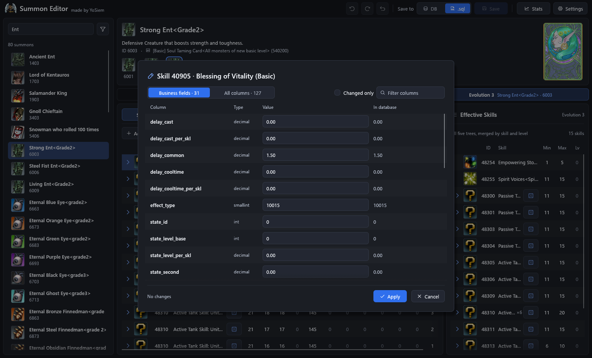
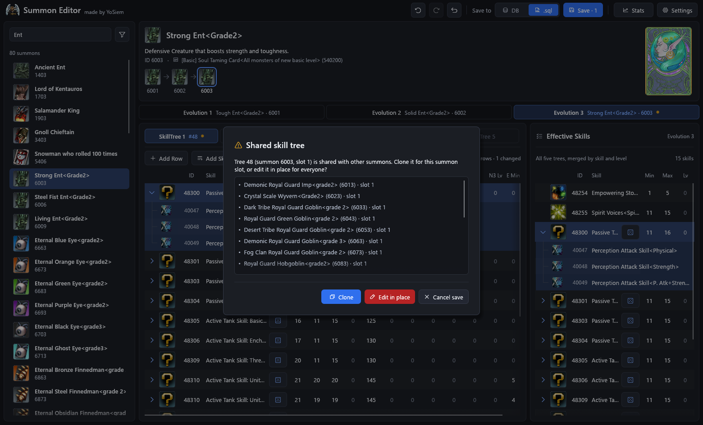
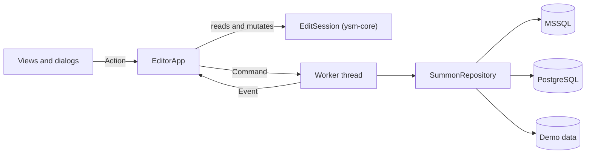

<div align="center">


# YSM Summon Editor

**A fast, native editor for Rappelz summon data: skill trees, skills, random skill groups and stat scaling.**

[](https://github.com/YoSiem/YSMSummonEditor/releases)


[](LICENSE)

[Download](https://github.com/YoSiem/YSMSummonEditor/releases) · [Quick start](#quick-start) · [Features](#features) · [Build from source](#build-from-source)

</div>


YSM Summon Editor is a single executable with nothing to install. Every edit is staged first, reviewed before it is saved, and then either written to the database (MSSQL or PostgreSQL) in one transaction or exported as an executable `.sql` script.

> [!WARNING]
> **Alpha.** This is a full rewrite of the original WPF/.NET editor in Rust. The SQL was carried over statement for statement, but the database layer has not yet been validated against a live server. Back up your database, and use **Save to `.sql`** to inspect what would be written before saving to the database directly.

## Contents

- [Features](#features)
- [Screenshots](#screenshots)
- [Quick start](#quick-start)
- [Configuration](#configuration)
- [Saving changes](#saving-changes)
- [Keyboard shortcuts](#keyboard-shortcuts)
- [Build from source](#build-from-source)
- [Architecture](#architecture)
- [Development](#development)
- [Coming from the .NET editor](#coming-from-the-net-editor)
- [License](#license)

## Features

**Browse**

- Live search by summon ID, name or card name, with filters for final evolutions and riding-only summons.
- The full three-stage evolution chain loads automatically from whichever stage you pick.
- Summon faces, skill icons and illustrations are read from your client dump folder (`png`, `jpg`, `bmp`, `webp`, `tga`, `dds`).

**Edit skill trees**

- All five tree slots of every evolution in one grid, edited in place with Tab and Enter.
- Add skills by name through a search picker instead of typing raw IDs.
- Duplicate and delete rows, with full **undo and redo**.
- An *Effective Skills* view merges the trees of an evolution by skill and level, and edits made there apply to every merged row.
- Rich in-game tooltips, rendered with the game's own colours and formatting.

**Edit skills, random groups and stats**

- A skill editor for every `SkillResource` column, with typed validation and a curated list of the fields you change most.
- A random skill group editor with search, a 15-skill limit, automatic sorting and `use_code`.
- A stat scaling editor for base stats and per-stage growth bonuses, with a live calculator for any level and enhance stage and a growth chart.

**Save safely**

- Nothing touches the database until you review the complete list of changes.
- Data shared with other summons is detected before saving, and you choose between cloning it for the edited summon or editing it in place for everyone.
- Save directly to MSSQL or PostgreSQL in a single transaction, or export an executable `.sql` script in the server's own SQL.
- Unsaved changes are protected when you switch summons or close the window.

## Screenshots

| | |
|---|---|
| **Stat scaling**: base stats, growth bonuses, calculator and growth chart | **Skill editor**: typed columns with change tracking |
|  |  |
| **Random skill group**: search on the left, candidates on the right | **Skill picker**: add tree rows by name |
|  |  |
| **Shared data**: clone for this summon or edit in place | **Review**: every change before it is saved |
|  |  |

The screenshots show the built-in demo data, which has no client images and therefore shows the placeholder icon everywhere.

## Quick start

1. Download `ysm-summon-editor.exe` from the [latest release](https://github.com/YoSiem/YSMSummonEditor/releases) and run it. No runtime is required.
2. Open **Settings**, pick the server type (MSSQL or PostgreSQL), enter the connection and press **Test connection**.
3. Point **Client dump folder** at your extracted client files to get icons and illustrations.
4. Pick a summon from the list and start editing.

Windows may show a SmartScreen prompt on first launch because the executable is not code-signed.

### Try it without a database

```powershell
ysm-summon-editor.exe --demo
```

Demo mode runs on built-in sample data held in memory. Every feature works, including saving, and nothing is written anywhere.

## Configuration

Settings are stored in `%LOCALAPPDATA%\YSMSummonEditor\settings.json` (`~/.local/share/YSMSummonEditor/settings.json` on Linux) and are edited in **Settings**. A database password typed there is kept in plain text.

| Setting | Notes |
|---|---|
| Server type | MSSQL or PostgreSQL. Settings files written before PostgreSQL support open as MSSQL. |
| Server, port, database, user, password | Password authentication over TCP. The port defaults to `1433` for MSSQL and `5432` for PostgreSQL. |
| Trust server certificate | MSSQL only. Accepts the server certificate without validating it, which is the usual choice for a local server. |
| Client dump folder | Scanned recursively for images. Defaults to `%USERPROFILE%\Desktop\Dump`, created on first run. |
| Theme | Dark (default), Light, or System, which follows the operating system live. Game tooltip colours are darkened on the light theme until they are readable. |
| Language | English or French, for the interface and the game texts: `StringResource`, or `StringResource_EN` in English when the database has that table. Until one is chosen, the operating system's language (French for a `fr` locale, English otherwise). |

### PostgreSQL

- Tables are found through the database's `search_path`, so a database migrated from MSSQL into a `dbo` schema works once `search_path` names it (`ALTER DATABASE <db> SET search_path = dbo, public`). Names are not quoted: the usual lower-case tables are found whatever the case written in the SQL.
- Leave the password empty to take it from the PostgreSQL password file, as `psql` does: `PGPASSFILE`, else `~/.pgpass` (`%APPDATA%\postgresql\pgpass.conf` on Windows). Nothing is then stored in `settings.json`.
- The connection is not encrypted (`NoTls`), which suits a local server.

### Bootstrap from `.env.local`

When no database is configured yet, the connection is read from a `.env.local` file in the working directory, the executable's directory or any parent of either:

```env
YSM_DB_CONNECTION_STRING=Server=127.0.0.1,1433;Database=YourDb;User Id=YourUser;Password=YourPass;TrustServerCertificate=True;Encrypt=False
```

For PostgreSQL, add `YSM_DB_PROVIDER`; `Host`, `Port` and `Username` are accepted as well:

```env
YSM_DB_PROVIDER=PostgreSQL
YSM_DB_CONNECTION_STRING=Host=127.0.0.1;Port=5432;Database=YourDb;Username=YourUser
```

[`.env.local.template`](.env.local.template) is a starting point. `.env.local` itself is ignored by git.

## Saving changes

Edits are staged, and the **Save** button shows how many are pending. Saving always follows the same path:

1. **Shared data check.** If an edited skill tree, stat row or random group is also used by summons outside the chain you are editing, you choose **Clone** (the edited summon gets its own copy) or **Edit in place** (the change applies to everyone). Edited skills and growth bonuses that are used elsewhere are listed so you can back out.
2. **Review.** Every insert, update and delete is listed with its before and after values, next to the equivalent SQL script.
3. **Write.** Depending on the **Save to** switch in the toolbar:
   - **DB** applies everything in a single transaction after one more confirmation, then reloads the summon from the database.
   - **.sql** writes the script to a file and leaves the database untouched. Staged changes stay staged.

The exported script is written for the configured server and runs as one transaction, so an error rolls everything back: T-SQL with `XACT_ABORT ON` for MSSQL, plain SQL between `BEGIN` and `COMMIT` for PostgreSQL (run it with `psql -v ON_ERROR_STOP=1 -f <file>`).

## Keyboard shortcuts

| Keys | Action |
|---|---|
| <kbd>Ctrl</kbd>+<kbd>S</kbd> | Review and save staged changes |
| <kbd>Ctrl</kbd>+<kbd>Z</kbd> / <kbd>Ctrl</kbd>+<kbd>Y</kbd> | Undo / redo tree and random group edits |
| <kbd>Ctrl</kbd>+<kbd>F</kbd> | Focus the summon search |
| <kbd>F5</kbd> | Reload the current summon from the database |
| <kbd>Insert</kbd> | Add a row to the current tree |
| <kbd>Del</kbd> | Delete the selected row |
| <kbd>Tab</kbd> / <kbd>Enter</kbd> | Commit the cell being edited |
| <kbd>Esc</kbd> | Cancel the cell edit or close a dialog |

Right-click a tree row for the full menu, including the random group actions.

## Build from source

Requires [Rust](https://rustup.rs) 1.88 or newer, on Windows or Linux.

```powershell
git clone https://github.com/YoSiem/YSMSummonEditor.git
cd YSMSummonEditor
cargo build --release -p ysm-summon-editor
```

The executable is written to `target\release\ysm-summon-editor.exe` (`target/release/ysm-summon-editor` on Linux). On Linux the window runs on Wayland or X11, and the build needs the OpenSSL headers (`libssl-dev` / `openssl-devel`) for the MSSQL driver.

## Architecture

The workspace has three crates with strict one-way dependencies:

| Crate | Responsibility |
|---|---|
| [`ysm-core`](crates/ysm-core) | Pure domain logic with no IO: models, the edit session with undo/redo, save planning, review rows, SQL script generation, the stat scaling calculator and the tooltip markup parser. |
| [`ysm-data`](crates/ysm-data) | The `SummonRepository` trait with an MSSQL implementation ([tiberius](https://github.com/prisma/tiberius)), a PostgreSQL one ([tokio-postgres](https://github.com/sfackler/rust-postgres)) and an in-memory one, plus settings, `.env.local` loading and the asset index. |
| [`ysm-summon-editor`](crates/ysm-summon-editor) | The [egui](https://github.com/emilk/egui) application: views, dialogs and the background worker. |

The UI thread never queries the database or decodes an image. Views push actions, the application reduces them, and a worker thread owns the connection:



Where to start when extending the editor:

- **A new query or write:** add a method to `SummonRepository` in [`repository.rs`](crates/ysm-data/src/repository.rs), then implement it in [`mssql/`](crates/ysm-data/src/mssql), [`pg/`](crates/ysm-data/src/pg) and [`memory.rs`](crates/ysm-data/src/memory.rs).
- **A new kind of staged change:** extend `EditSession` in [`session/`](crates/ysm-core/src/session), then `CommitRequest`, `sql_script.rs` and `review.rs`.
- **A new screen:** add a dialog under [`dialogs/`](crates/ysm-summon-editor/src/dialogs), an `Action` that opens it, and its handling in [`app/actions.rs`](crates/ysm-summon-editor/src/app/actions.rs).

Tables read and written: `SummonResource`, `SkillTreeResource`, `SkillResource`, `SummonRandomSkillResource`, `StatResource`, `CreatureLevelBonus`, `CreatureEnhance`, `StringResource`, `ItemResource`.

## Development

```powershell
cargo test --workspace
cargo clippy --workspace --all-targets -- -D warnings
cargo fmt --all
```

The MSSQL and PostgreSQL layers have read-only smoke tests that only run on request, against a database you point them at:

```powershell
$env:YSM_MSSQL_TEST_CONNECTION = "Server=...;Database=...;User Id=...;Password=...;TrustServerCertificate=True"
$env:YSM_PG_TEST_CONNECTION = "Host=...;Database=...;Username=..."
cargo test -p ysm-data -- --ignored
```

PostgreSQL also has a write test that goes through every kind of save and a failed one. It **changes the data**: run it only on a disposable copy of a database. With `YSM_PG_WRITE_TEST_SCRIPT` set, it also appends the `.sql` export of each save to that file; replayed with `psql` on a second copy, it must leave the same rows.

```powershell
$env:YSM_PG_WRITE_TEST_CONNECTION = "Host=...;Database=<disposable copy>;Username=..."
cargo test -p ysm-data --test pg_live_write -- --ignored --nocapture
```

Debug builds can play back a UI script and save screenshots, which is how the images in this README were made:

```powershell
$env:YSM_DEV_SCRIPT = "select 1013; stats; wait 20; shot stats.png; quit"
cargo run -p ysm-summon-editor -- --demo
```

The available steps are listed in [`devtools.rs`](crates/ysm-summon-editor/src/app/devtools.rs).

## Coming from the .NET editor

Versions up to and including the last WPF build required the .NET 10 Desktop Runtime. This version replaces it entirely and reads the same `settings.json` and `.env.local`, so an existing setup keeps working without changes.

What behaves differently:

- **`.sql` export is executable.** The original wrote upserts and clone steps as comments. The script now contains real statements and allocates the IDs of cloned rows itself.
- **Reopening an editor keeps staged edits.** The skill and stat editors start from the staged values and measure changes against the database, so applying twice never drops an edit.
- **Tree changes follow row identity.** Inserting a row in the middle of a tree is reviewed as one insert, not as a cascade of updates.
- **Reloading after a clone is correct.** After a shared tree or stat row is cloned on save, the summon is read again, so the editor shows the new IDs.
- **Orphaned placeholder groups are not saved.** An empty random group created by typing a group ID is dropped once no row points at it.

The WPF source remains available in the git history before `v0.1.0-alpha`.

## License

Released under the [MIT License](LICENSE).

---

<div align="center">
made by YoSiem
</div>
