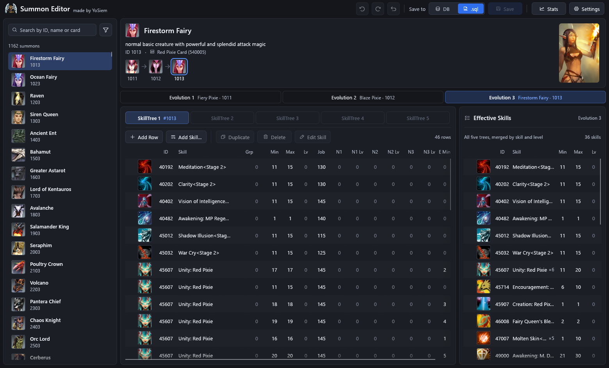
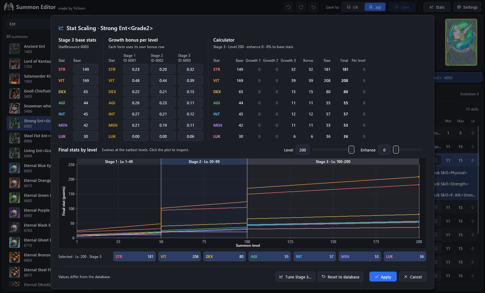
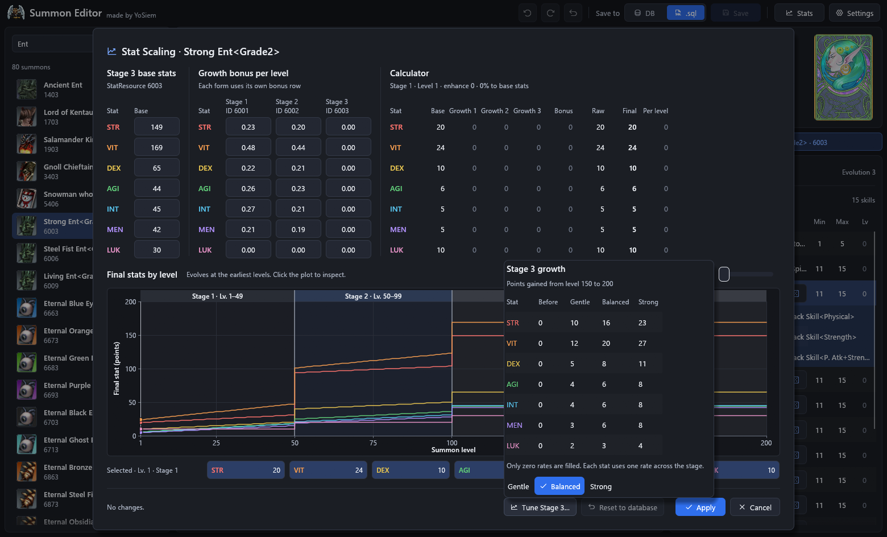
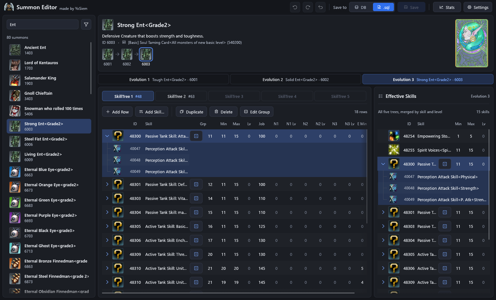
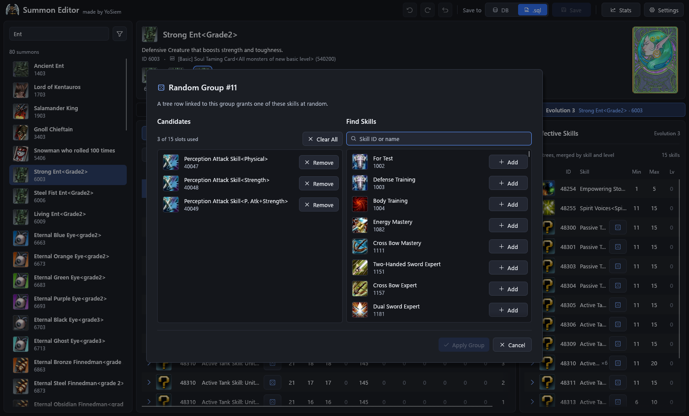
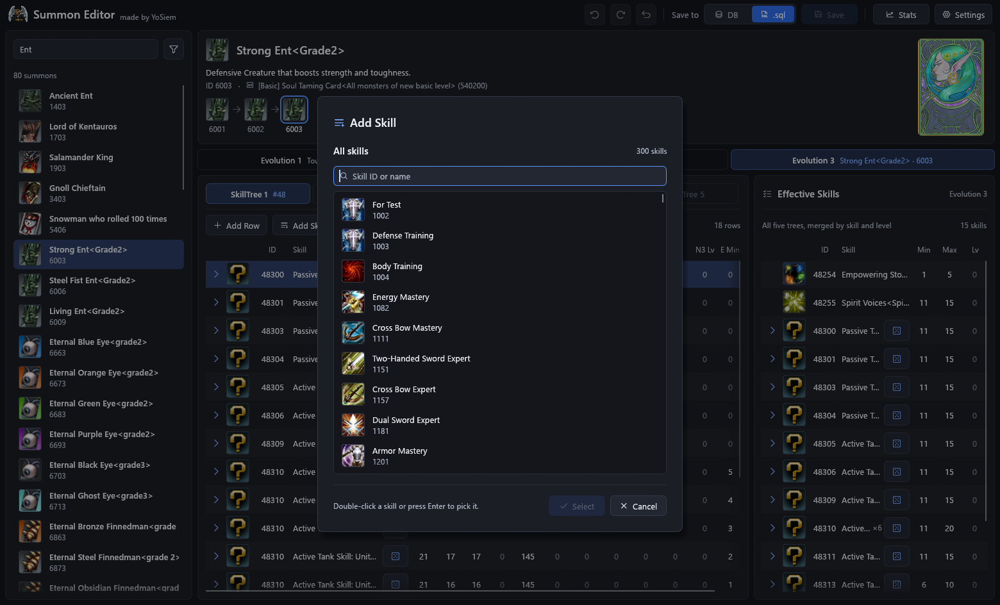
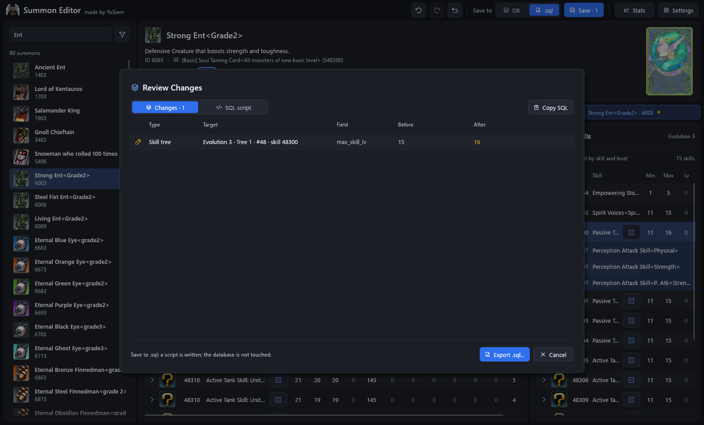
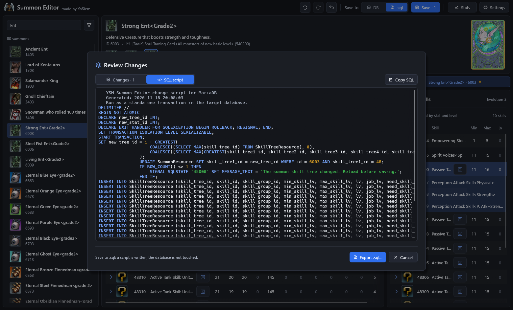
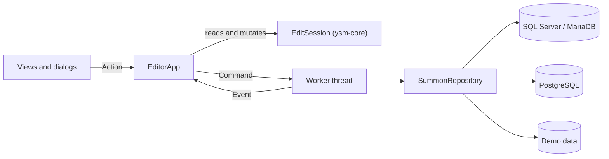

<div align="center">


# YSM Summon Editor

**A fast, native editor for Rappelz summon data: skill trees, skills, random skill groups and stat scaling.**

[](https://github.com/YoSiem/YSMSummonEditor/releases)


[](LICENSE)

[Download](https://github.com/YoSiem/YSMSummonEditor/releases) · [Quick start](#quick-start) · [Features](#features) · [Build from source](#build-from-source)

</div>



YSM Summon Editor is a single executable with nothing to install. Every edit is staged first, reviewed before it is saved, and then either written to SQL Server, MariaDB or PostgreSQL in one transaction or exported as an executable `.sql` script for the selected engine.

> [!WARNING]
> **Alpha.** Back up your database and use **Save to `.sql`** to inspect the generated statements before saving to the database directly.

## Contents

- [Features](#features)
- [Screenshots](#screenshots)
- [Quick start](#quick-start)
- [Configuration](#configuration)
- [Saving changes](#saving-changes)
- [Keyboard shortcuts](#keyboard-shortcuts)
- [Build from source](#build-from-source)
- [Architecture](#architecture)
- [Development](#development)
- [Coming from the .NET editor](#coming-from-the-net-editor)
- [License](#license)

## Features

**Browse**

- One result per evolution chain, shown using its final form. Search by any stage's ID or name, or by card name. Riding-only summons can be included through the list filter.
- Selecting a summon opens its full evolution chain. Use the evolution tabs to switch between forms.
- Summon faces, skill icons and illustrations are read from your client dump folder (`png`, `jpg`, `bmp`, `webp`, `tga`, `dds`).

**Edit skill trees**

- All five tree slots of every evolution in one grid, edited in place with Tab and Enter.
- Add skills by name through a search picker instead of typing raw IDs.
- Duplicate and delete rows, with full **undo and redo**.
- An *Effective Skills* view merges the trees of an evolution by skill and level, and edits made there apply to every merged row.
- Rich in-game tooltips, rendered with the game's own colours and formatting.

**Edit skills, random groups and stats**

- A skill editor for every `SkillResource` column, with typed validation and a curated list of the fields you change most.
- In either the skill tree or **Effective Skills**, click the chevron to see a group’s candidates under the row. Double-click a candidate to edit the skill, or click the dice to edit the group. The group editor includes search, a 15-skill limit and automatic sorting and `use_code`.
- In **Stats**, inspect points at any level and use the legend to toggle individual stats. Clicking or dragging across the chart updates the calculator to the form at that level.
- **Tune Stage 3** compares **Gentle**, **Balanced** and **Strong** over levels 150–200. Each preset uses the summon’s base stats and earlier growth to suggest values for zero rates. Choose a preset to preview it, then click **Apply** to stage it for the normal save review.
- The MariaDB chart follows AurumisRZ’s evolution chain up to level 200, with transitions at the first eligible levels. Each form uses its own base stats and bonus. Enhance scales base stats before the level bonus is added.

**Save safely**

- Nothing touches the database until you review the complete list of changes.
- Data shared with other summons is detected before saving, and you choose between cloning it for the edited summon or editing it in place for everyone.
- Preview syntax-highlighted SQL, save directly to SQL Server, MariaDB or PostgreSQL in a single transaction, or export a script for the selected engine.
- Unsaved changes are protected when you switch summons or close the window.

## Screenshots

| | |
|---|---|
| **Evolution chart** | **Stage 3 tuning** |
|  |  |
| **Inline random groups** | **Random group editor** |
|  |  |
| **Skill editor** | **Skill picker** |
|  |  |
| **Shared data prompt** | **Save review** |
|  |  |

**SQL preview** shows the script for the selected database engine with syntax highlighting and a **Copy SQL** button.



Captured with AurumisRZ data and client assets. Connection details are cropped out.

## Quick start

1. Download `ysm-summon-editor.exe` from the [latest release](https://github.com/YoSiem/YSMSummonEditor/releases) and run it. No runtime is required.
2. Open **Settings**, choose **SQL Server**, **MariaDB** or **PostgreSQL**, enter the connection details and press **Test connection**. The database must have the five-slot summon skill-tree schema.
3. Point **Client dump folder** at your extracted client files to get icons and illustrations.
4. Pick a summon from the list and start editing.

Windows may show a SmartScreen prompt on first launch because the executable is not code-signed.

### Try it without a database

```powershell
ysm-summon-editor.exe --demo
```

Demo mode runs on built-in sample data held in memory. Every feature works, including saving, and nothing is written anywhere.

## Configuration

Settings are stored in `%LOCALAPPDATA%\YSMSummonEditor\settings.json` (`~/.local/share/YSMSummonEditor/settings.json` on Linux) and are edited in **Settings**. A database password typed there is kept in plain text.

| Setting | Notes |
|---|---|
| Engine | SQL Server, MariaDB or PostgreSQL. Settings files without an engine open as SQL Server. |
| Server, port, database, user, password | Database authentication over TCP. The default ports are `1433` for SQL Server, `3306` for MariaDB and `5432` for PostgreSQL. |
| Trust server certificate | SQL Server and MariaDB. Accepts the server certificate without validating it. The MariaDB connection uses TLS. |
| Client dump folder | Scanned recursively for images. Defaults to `%USERPROFILE%\Desktop\Dump`, created on first run. |

### PostgreSQL

- Tables are found through the database's `search_path`, so a database migrated from SQL Server into a `dbo` schema works once `search_path` names it (`ALTER DATABASE <db> SET search_path = dbo, public`). Names are not quoted: the usual lower-case tables are found whatever the case written in the SQL.
- Leave the password empty to take it from the PostgreSQL password file, as `psql` does: `PGPASSFILE`, else `~/.pgpass` (`%APPDATA%\postgresql\pgpass.conf` on Windows). Nothing is then stored in `settings.json`.
- The connection is not encrypted (`NoTls`), which suits a local server.

### Bootstrap from `.env.local`

When no database is configured yet, a SQL Server connection can be read from a `.env.local` file in the working directory, the executable's directory or any parent of either:

```env
YSM_DB_CONNECTION_STRING=Server=127.0.0.1,1433;Database=YourDb;User Id=YourUser;Password=YourPass;TrustServerCertificate=True;Encrypt=False
```

For MariaDB or PostgreSQL, add `YSM_DB_PROVIDER` (`MariaDB` or `PostgreSQL`); `Host`, `Port` and `Username` are accepted as well:

```env
YSM_DB_PROVIDER=PostgreSQL
YSM_DB_CONNECTION_STRING=Host=127.0.0.1;Port=5432;Database=YourDb;Username=YourUser
```

[`.env.local.template`](.env.local.template) is a starting point. `.env.local` itself is ignored by git.

## Saving changes

Edits are staged, and the **Save** button shows how many are pending. Saving always follows the same path:

1. **Shared data check.** If an edited skill tree, stat row or random group is also used by summons outside the chain you are editing, you choose **Clone** (the edited summon gets its own copy) or **Edit in place** (the change applies to everyone). Edited skills and growth bonuses that are used elsewhere are listed so you can back out.
2. **Review.** The **Changes** tab lists before and after values. The **SQL script** tab shows the equivalent syntax-highlighted SQL, which you can copy.
3. **Write.** Depending on the **Save to** switch in the toolbar:
   - **DB** applies everything in a single transaction after one more confirmation, then reloads the summon from the database.
   - **.sql** writes the script to a file and leaves the database untouched. Staged changes stay staged.

Run the exported script as a standalone transaction in the target database. SQL Server uses `XACT_ABORT ON`. For MariaDB, run the script in the `mariadb` client, which recognizes the delimiter directives and passes the transaction block to the server. For PostgreSQL the script is plain SQL between `BEGIN` and `COMMIT`; run it with `psql -v ON_ERROR_STOP=1 -f <file>`.

## Keyboard shortcuts

| Keys | Action |
|---|---|
| <kbd>Ctrl</kbd>+<kbd>S</kbd> | Review and save staged changes |
| <kbd>Ctrl</kbd>+<kbd>Z</kbd> / <kbd>Ctrl</kbd>+<kbd>Y</kbd> | Undo / redo tree and random group edits |
| <kbd>Ctrl</kbd>+<kbd>F</kbd> | Focus the summon search |
| <kbd>F5</kbd> | Reload the current summon from the database |
| <kbd>Insert</kbd> | Add a row to the current tree |
| <kbd>Del</kbd> | Delete the selected row |
| <kbd>Tab</kbd> / <kbd>Enter</kbd> | Commit the cell being edited |
| <kbd>Esc</kbd> | Cancel the cell edit or close a dialog |

Right-click a tree row for the full menu, including the random group actions.

## Build from source

Requires [Rust](https://rustup.rs) 1.88 or newer, on Windows or Linux.

```powershell
git clone https://github.com/YoSiem/YSMSummonEditor.git
cd YSMSummonEditor
cargo build --release -p ysm-summon-editor
```

The executable is written to `target\release\ysm-summon-editor.exe` (`target/release/ysm-summon-editor` on Linux). On Linux the window runs on Wayland or X11, and the build needs the OpenSSL headers (`libssl-dev` / `openssl-devel`) for the SQL Server and MariaDB drivers.

## Architecture

The workspace has three crates with strict one-way dependencies:

| Crate | Responsibility |
|---|---|
| [`ysm-core`](crates/ysm-core) | Pure domain logic with no IO: models, the edit session with undo/redo, save planning, review rows, SQL script generation, the stat scaling calculator and the tooltip markup parser. |
| [`ysm-data`](crates/ysm-data) | The `SummonRepository` trait with SQL Server, MariaDB, PostgreSQL ([tokio-postgres](https://github.com/sfackler/rust-postgres)) and in-memory implementations, plus settings, `.env.local` loading and the asset index. |
| [`ysm-summon-editor`](crates/ysm-summon-editor) | The [egui](https://github.com/emilk/egui) application: views, dialogs and the background worker. |

The UI thread never queries the database or decodes an image. Views push actions, the application reduces them, and a worker thread owns the connection:



Where to start when extending the editor:

- **A new query or write:** add a method to `SummonRepository` in [`repository.rs`](crates/ysm-data/src/repository.rs), then implement it in [`mssql/`](crates/ysm-data/src/mssql), [`pg/`](crates/ysm-data/src/pg) and [`memory.rs`](crates/ysm-data/src/memory.rs).
- **A new kind of staged change:** extend `EditSession` in [`session/`](crates/ysm-core/src/session), then `CommitRequest`, `sql_script.rs` and `review.rs`.
- **A new screen:** add a dialog under [`dialogs/`](crates/ysm-summon-editor/src/dialogs), an `Action` that opens it, and its handling in [`app/actions.rs`](crates/ysm-summon-editor/src/app/actions.rs).

Tables read and written: `SummonResource`, `SkillTreeResource`, `SkillResource`, `SummonRandomSkillResource`, `StatResource`, `CreatureLevelBonus`, `CreatureEnhance`, `StringResource`, `ItemResource`.

## Development

```powershell
cargo test --workspace
cargo clippy --workspace --all-targets -- -D warnings
cargo fmt --all
```

The SQL Server layer has a read-only smoke test that only runs on request, against a database you point it at:

```powershell
$env:YSM_MSSQL_TEST_CONNECTION = "Server=...;Database=...;User Id=...;Password=...;TrustServerCertificate=True"
cargo test -p ysm-data live_database_smoke_test -- --ignored
```

For the local AurumisRZ setup, configure MariaDB and the client dump in **Settings**, then run the read and transaction checks:

```powershell
cargo test -p ysm-data --test live_mariadb -- --ignored
cargo test -p ysm-data mariadb_commit_preserves_tree_values_and_rolls_back_on_error -- --ignored
```

The transaction check uses temporary tables scoped to its database connection.

The PostgreSQL layer has a read-only smoke test, and a write test that goes through every kind of save and a failed one. The write test **changes the data**: run it only on a disposable copy of a database. With `YSM_PG_WRITE_TEST_SCRIPT` set, it also appends the `.sql` export of each save to that file; replayed with `psql` on a second copy, it must leave the same rows.

```powershell
$env:YSM_PG_TEST_CONNECTION = "Host=...;Database=...;Username=..."
cargo test -p ysm-data pg::tests::live -- --ignored
$env:YSM_PG_WRITE_TEST_CONNECTION = "Host=...;Database=<disposable copy>;Username=..."
cargo test -p ysm-data --test pg_live_write -- --ignored --nocapture
```

Debug builds can play back a UI script and save screenshots, which is how the images in this README were made:

```powershell
$env:YSM_DEV_SCRIPT = "select 1013; stats; wait 20; shot stats.png; quit"
cargo run -p ysm-summon-editor -- --demo
```

The available steps are listed in [`devtools.rs`](crates/ysm-summon-editor/src/app/devtools.rs).

## Coming from the .NET editor

Versions up to and including the last WPF build required the .NET 10 Desktop Runtime. This version replaces it entirely and reads the same `settings.json` and `.env.local`, so an existing setup keeps working without changes.

What behaves differently:

- **`.sql` export is executable.** The original wrote upserts and clone steps as comments. The script now contains real statements and allocates the IDs of cloned rows itself.
- **Reopening an editor keeps staged edits.** The skill and stat editors start from the staged values and measure changes against the database, so applying twice never drops an edit.
- **Tree changes follow row identity.** Inserting a row in the middle of a tree is reviewed as one insert, not as a cascade of updates.
- **Reloading after a clone is correct.** After a shared tree or stat row is cloned on save, the summon is read again, so the editor shows the new IDs.
- **Orphaned placeholder groups are not saved.** An empty random group created by typing a group ID is dropped once no row points at it.

The WPF source remains available in the git history before `v0.1.0-alpha`.

## License

Released under the [MIT License](LICENSE).

---

<div align="center">
made by YoSiem
</div>
